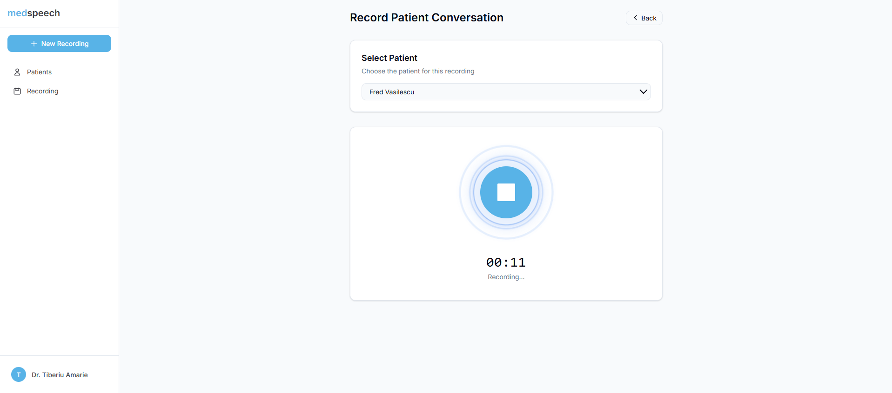
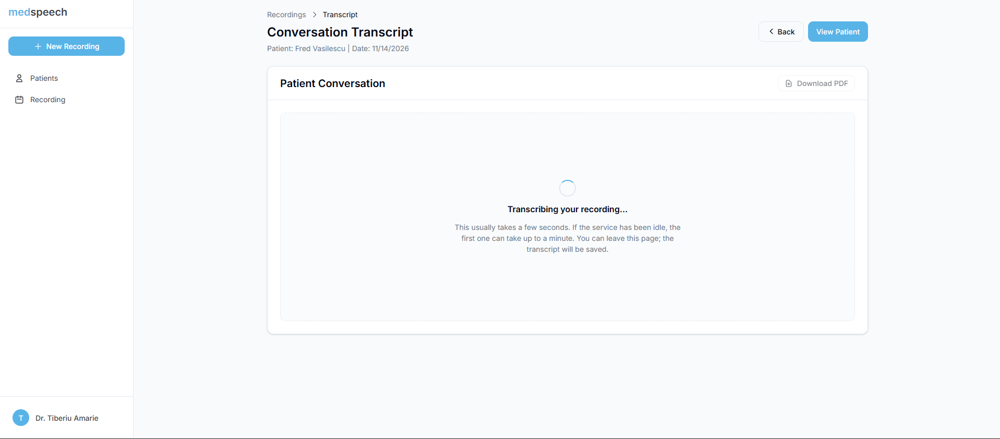

# medspeech: ASR for Medical Conversations

Bachelor's thesis, Babeș-Bolyai University, Cluj-Napoca (2025). Supervisor: Prof. Czibula Istvan Gergely.

I fine-tuned OpenAI Whisper with LoRA for medical speech and shipped it inside a web app where doctors record, transcribe and manage patient consultations.

**Live demo:** [medspeech.pages.dev](https://medspeech.pages.dev) · **Thesis:** [thesis.pdf](thesis.pdf) · **Model API:** [Hugging Face Space](https://huggingface.co/spaces/Tiberiw/thesis-asr)

> The back-end runs on Render's free tier, so the first request after idle can take ~1 min to wake up.

## Screenshots

**Recording a consultation**



**Transcription runs in the background**



## Results

Fine-tuned on the Syn-Med dataset (79k clips, a 10% subset of 5,486 h of synthetic medical speech), 80/10/10 split, on one A100 40 GB.

| Model | WER before | WER after LoRA (r = 32) |
|---|---|---|
| whisper-large-v3-turbo (0.8B) | 8.75% | **8.26%** |
| whisper-base (74M) | 11.37% | 12.84% |

- LoRA adapters on the attention query/value projections only (alpha = 2r, dropout 0.1). I compared ranks 16/32/64; r = 32 worked best (16 underfit, 64 overfit).
- The live demo serves the whisper-base adapter on CPU so it stays free to host.

## Stack

| Part | Tech |
|---|---|
| Frontend | Angular 19, Tailwind 4, Cloudflare Pages |
| Back-end | NestJS 11, TypeORM, PostgreSQL (Neon), Google sign-in + JWT, socket.io, multi-tenant data isolation, Render |
| ASR service | Whisper + PEFT/LoRA, Gradio API, Hugging Face Spaces |
| Training | PyTorch, Hugging Face Transformers/PEFT, Jupyter |

## Features

- Record a consultation in the browser; transcription runs in the background, with live notifications.
- Patient records with consultation history and transcripts.
- Edit transcripts and export them to PDF.
- Google sign-in; each clinic's data is isolated per tenant.

## Repo layout

```
frontend/         Angular SPA
back-end/         NestJS REST + WebSocket API
model-inference/  Gradio Whisper service (deployed to HF Spaces)
training/         Dataset prep and analysis notebooks
thesis.pdf        Full thesis
```

## Run locally

```bash
# back-end (needs Postgres; copy .env.example to .env)
cd back-end && npm install && npm run start:dev
# frontend
cd frontend && npm install && npm start
# ASR service (needs ffmpeg and HF_TOKEN)
cd model-inference && pip install -r requirements.txt && python app.py
```
